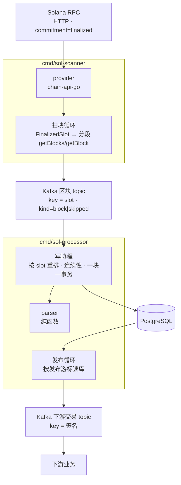
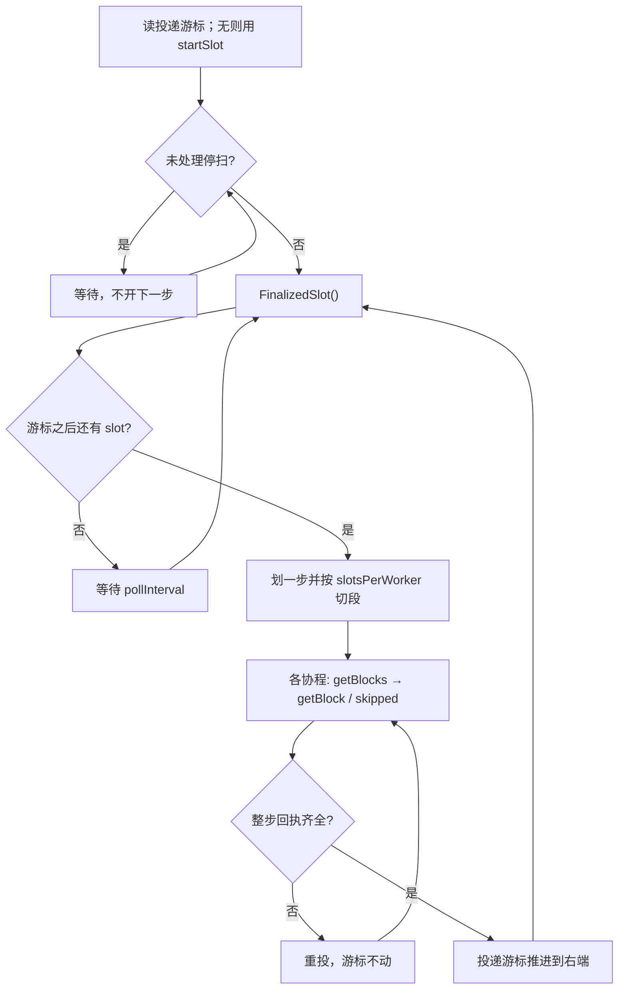
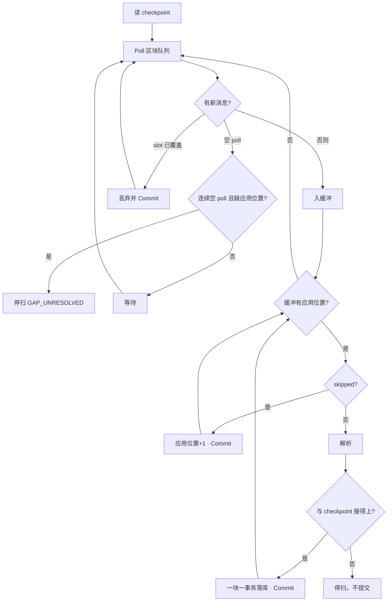

# sol-scanner-service

只读 Solana **finalized** 扫链服务：同一仓库两个进程——扫块投递区块队列，处理侧解析、一块一事务落库，再按发布游标发下游交易（至少一次，key=签名）。

不做回滚 topic、不回补 `startSlot` 之前的历史、不判断充值/提现业务语义。产品与数据契约以 [`docs/superpowers/001-sol-scanner-v1/design.md`](docs/superpowers/001-sol-scanner-v1/design.md) 为准；规格三件套见同目录 `spec.md` / `plan.md` / `tasks.md`（当前基线 `PLAN-v1.6.5`）。

> 总体验收（PLAN-028）已通过；当前 Infura 环境下 A-04 吞吐门禁为 **blocked**，**不声称已上线或可生产运行**。高吞吐 RPC 下才可将 FA-04 标为 passed。

## 架构



| 进程 | 做什么 | 不做什么 |
| --- | --- | --- |
| `sol-scanner` | HTTP 拉 finalized；按 `stepSlots` / `slotsPerWorker` 分段投递 | 不解析、不写业务表、不发下游交易 |
| `sol-processor` | 消费区块队列、解析、落库、按游标发下游 | 不访问 RPC |

区块 topic 是内部队列；交易 topic 才给下游。下游不通时仍可落库，发布循环从游标补发；区块队列不通时扫块不推进投递游标。

## 数据流

### 扫块一步

先 `FinalizedSlot()`，再划本步左右端并切段；整步成功才推进投递游标。



### 处理落库

单写协程按 slot 应用；skipped 只推进应用位置，不改 checkpoint。



停扫后：不再落新块；已入库数据继续发布；扫块不开下一步；两进程不因停扫自行退出。

## 目录（摘要）

```text
cmd/sol-scanner|sol-processor|migrate
internal/
  scanner/ (+ provider)     # 扫块
  processor/ (+ parser)     # 落库与解析
  event/block|transaction   # 区块队列 / 下游消息
  repository/ (+ postgre)   # 仓储
  ioc/ (+ scanner|processor)# 装配 InitX
  config/ domain/ pkg/
scripts/postgre/            # 迁移 SQL 权威
docs/superpowers/001-sol-scanner-v1/
```

依赖方向：`cmd → ioc → {scanner|processor|event|repository|…} → domain`。处理进程不得依赖 `provider` / `chain-api-go`。

## 快速开始

1. 复制 [`config/config.example.yaml`](config/config.example.yaml) 为 gitignore 的 `config/config.local.yaml`，填入 `${INFURA_API_KEY}` / `${POSTGRES_DSN}` 等（密钥勿提交）。
2. 迁移与进程（Kafka 相关需 `CGO_ENABLED=1`）：

```sh
go run ./cmd/migrate up --config ./config/config.local.yaml
CGO_ENABLED=1 go run ./cmd/sol-scanner --config ./config/config.local.yaml
CGO_ENABLED=1 go run ./cmd/sol-processor --config ./config/config.local.yaml
```

3. 测试：

```sh
go test ./...          # 离线；Kafka 包需 CGO_ENABLED=1
go vet ./...
go build ./...
gofmt -l .
make e2e               # 专用 Compose PostgreSQL + Kafka，退出清理
```

主网只读验收另需 `SOL_SCANNER_LIVE_E2E=1` 且 DSN 主机为本机；证据不得含完整 URL / DSN / API key。无 `make lint`、无通用 `serve`。

## 技术栈

| 项 | 选择 |
| --- | --- |
| Go | `go.mod` 声明版本 |
| 链访问 | 已发布 `chain-api-go`（禁止 `replace`） |
| DB | PostgreSQL + GORM；E2E 用 Compose PostgreSQL 14.14 |
| 配置 | `yaml.v3`，KnownFields + `${VAR}` 展开 |
| Kafka | `confluent-kafka-go`（CGO） |

更细的表结构、消息 JSON、停扫原因与验收口径见 `design.md` 与规格三件套。
