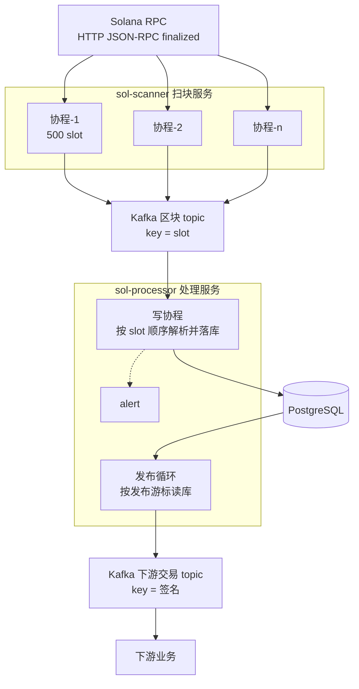
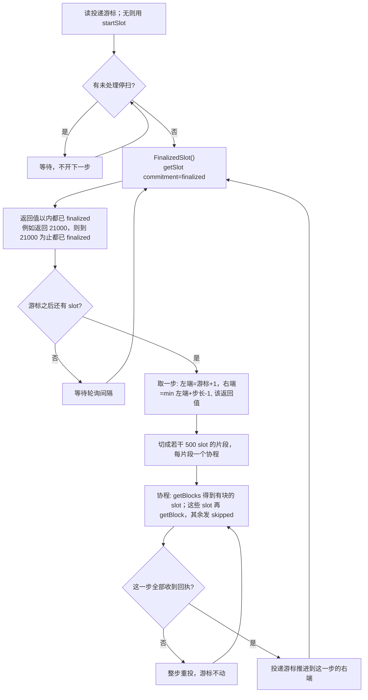
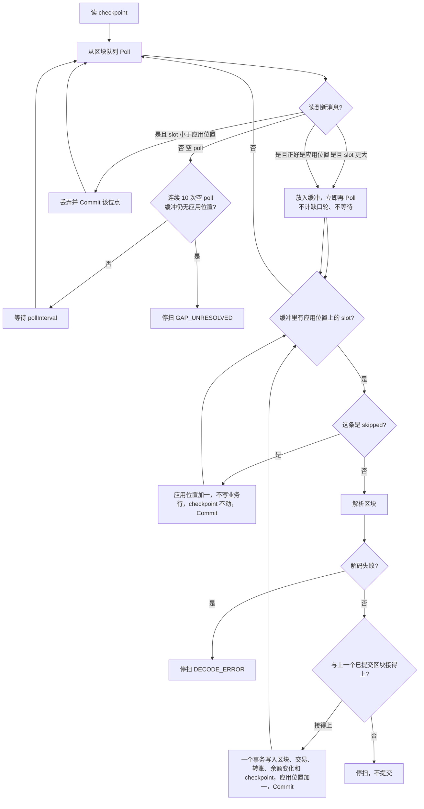
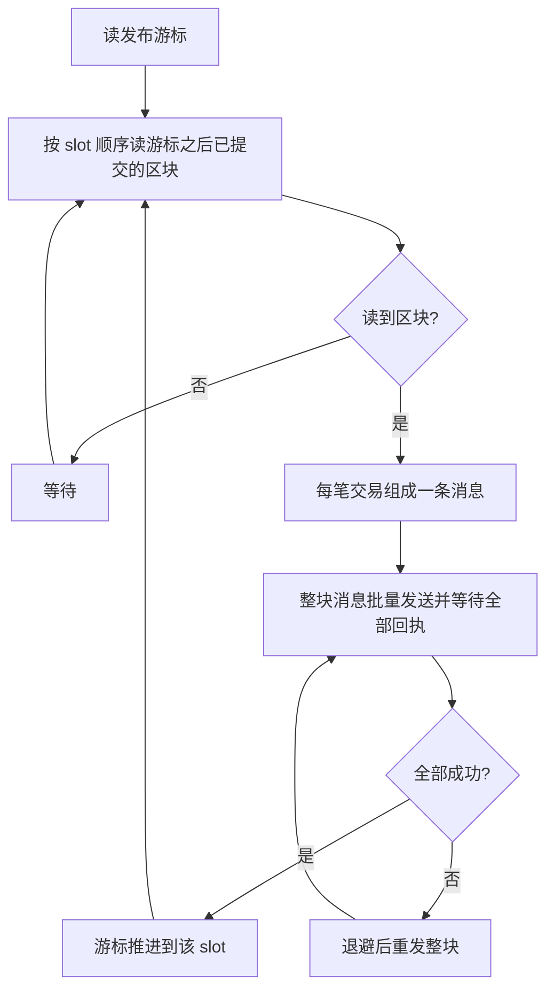

# Solana 扫链服务整体方案设计

- 日期：2026-11-23
- 状态：架构修订已确认。规格三件套当前基线 `PLAN-v1.6.5-SOL-SCANNER-v1`（Human 2026-11-23 批准；含 v1.6.3 写协程澄清、v1.6.4 PLAN-028 live 稳定性路径扩权与 v1.6.5 A-04 逻辑与环境分离）；产品架构仍以本文件为准
- 参考：扫块与落库拆成两个服务（扫块协程 → 区块队列 → 写协程落库，再发给下游）。代码约定仍参考 `evm-scanner-service`；链访问用 `chain-api-go`。

本修订替换原先「同一进程里先入库、再按游标发给下游」的架构。解析口径、表结构和下游交易消息不变。本文件已确认。规格三件套随 `PLAN-v1.6.x` 修订；已经按旧架构写下的代码仍然不能当作目标架构。

文中术语：

- **slot**：Solana 的出块时间槽，约 200 毫秒一个；有的 slot 没有区块（被跳过）。
- **finalized**：区块已最终确认，不会再被回滚。
- **投递游标**：扫块服务记下的位置，表示「哪些 slot 已经成功交给区块队列」。
- **checkpoint**：处理服务库里的位置，表示「哪些区块已经解析并提交进 PostgreSQL」。
- **发布游标**：处理服务库里的一行，记下「哪些已入库区块已经成功交给下游交易 topic」。它不是 Kafka 的消费位点。

## 1. 目标

### 1.1 要做到的事

1. **扫块服务**只用 HTTP 拉取主网 finalized 区块，从投递游标的下一个 slot 连续覆盖到当前 finalized slot，按步长切给多个协程，把原始区块投进区块队列。它不解析交易，不写链上业务表。轮询间隔不跳 slot。
2. **处理服务**从区块队列按 slot 顺序取出，解析交易、转账指令（含内层）和 Token-2022 余额变化，一个区块一个事务写入 PostgreSQL。不判断充值、提现等业务语义。
3. 处理服务在入库之后，按发布游标把每笔交易发给下游交易 topic，至少送达一次。
4. 新区块与已入库区块接不上，或范围内指令解码失败时，处理服务停止落库并告警，不自动修数据。扫块服务看到未处理停扫记录后不再开下一步。
5. 所有链上访问都通过 `chain-api-go`，本仓库直接依赖它发布的版本，不使用 `replace`。

### 1.2 已确定的决策

| 事项 | 结论 |
|---|---|
| 进程 | 两个服务：`sol-scanner` 只扫块并投递；`sol-processor` 消费、解析、落库，再发给下游 |
| 扫描方式 | 只用 HTTP，只扫 finalized；下游每笔交易只发一次，不设回滚 topic |
| 扫块切分 | 一步扫一段连续 slot。示例：步长 20000，每协程 500 个 slot，协程数 = 20000 / 500 = 40 |
| 区块队列 | 扫块与落库之间的 Kafka topic，一条消息一个 slot，key=slot |
| 范围 | 全链全量。PostgreSQL 不存原始区块 JSON；原始区块只在队列消息里，直到处理服务提交成功 |
| 起扫位置 | 配置里显式指定，只往前扫，不回补起点之前的历史 |
| transfer 口径 | 按指令解析，包含内层指令。解析发生在处理服务 |
| 失败交易 | 入库并发送，标记为失败，不带 transfer |
| 下游消息 | 一笔交易一条消息，transfer 内嵌，key 为签名 |
| 带手续费的代币 | 消息里附带 Token-2022 账户在交易前后的余额 |
| 关闭 token 账户 | 不产出 transfer |
| 保留期 | 90 天；本期不做过期清理，表不分区 |
| Kafka 客户端 | `confluent-kafka-go`，参考 `notification-platform` 的 `mqx` 并做三处修改 |
| 告警 | 定义接口，本期只有写日志的实现，以后接 Lark |
| 停扫后 | 处理服务停止继续落库，但已入库数据继续发给下游。扫块服务不再开下一步。两个进程都不因停扫自行退出 |
| 签名索引 | 不建；按签名回查时带上 slot |
| RPC 地址 | 测试用 Infura Solana 主网；密钥不进仓库，做法与 EVM 仓库一致 |
| SDK 缺口 | 在 `chain-api-go` 补 `GetBlocks` 和 `GetFirstAvailableBlock`，发布版本后本仓库再依赖 |

### 1.3 为什么只扫 finalized、不做回滚

Solana 主网在 2026-10-21 切换到 Alpenglow 共识后，`confirmed` 与 `finalized` 是同一个状态，最终确认约 150 毫秒。finalized 区块不会回滚，所以不需要“安全位”和“终态位”两段状态，也不需要回滚 topic。作为兜底，每个新区块入库前都要校验它与上一个已入库区块接得上，接不上就停扫告警。

### 1.4 量级

以下数字来自主网少量区块的抽样，是粗估：

| 指标 | 数值 |
|---|---|
| 出块速度 | 约每秒 5 个区块 |
| 每个区块的交易数 | 300 到 800 笔，约一半是失败交易 |
| 每天交易行数 | 约 2 亿 |
| 每天 transfer 行数 | 约 4 亿 |
| 每天 Token-2022 余额变化行数 | 约 7000 万 |
| 每天磁盘增长 | 约 200GB（不含索引，按每行 250 到 350 字节估算，未实测） |
| 90 天磁盘 | 约 18TB |

### 1.5 不做的事

- WebSocket、非 finalized 的确认级别、自动回滚。
- 业务语义判断、地址白名单过滤。
- 回补起扫位置之前的历史区块。
- 过期数据清理、表分区、多 RPC 节点切换、Lark 实现、监控指标。
- System、SPL Token、Token-2022 以外的程序（质押、DEX 等）。
- 关闭 token 账户时退回的租金、每条 transfer 的实际到账额计算。
- 人工改库后的重发。发布游标只往前走；已经越过的区块，本期没有“再发一次”的入口。崩溃后的自动重试不受影响，那种重发的内容与第一次相同。
- 处理服务水平扩成多个写库实例。连续性是全局的，本期只有一个写协程按 slot 顺序落库。并行只发生在扫块服务。

## 2. 架构图



| 组件 | 所在服务 | 职责 | 不做什么 |
|---|---|---|---|
| provider | 扫块服务 | 调用 `chain-api-go`，统一超时、重试和错误分类 | 不解析业务数据 |
| 扫块协程 | 扫块服务 | 领取一段连续 slot，列出有块的 slot，拉取区块，投进区块队列 | 不解析、不写链上业务表、不发给下游 |
| parser | 处理服务 | 把一个区块转成要入库的行，纯函数 | 不访问网络和数据库 |
| 写协程 | 处理服务 | 从队列按 slot 重排，校验连续性，一个事务落库 | 不访问 RPC |
| 发布循环 | 处理服务 | 按发布游标读已提交区块，组下游消息并发送 | 不访问 RPC，不重解析 |
| repository | 两边各自的表 | 扫块服务只读写投递游标；处理服务读写链上表、checkpoint、停扫、发布游标 | 不做业务判断 |
| alert | 处理服务 | 停扫时发告警 | 本期不接外部平台 |

两个队列分开：区块 topic 是扫块和处理之间的内部队列；交易 topic 才是给下游业务的。下游 Kafka 不通时，写协程仍可继续落库，发布循环从游标补发。区块队列不通时，扫块服务不推进投递游标。

## 3. 流程图

### 3.1 扫块服务

一步的长度和每协程负责的 slot 数可配置。图中的例子是：要扫的步长 20000，开始 slot 1000，结束 slot 21000；1 个协程负责 500 个 slot，协程数 = 20000 / 500 = 40。追平最新区块时，最后一步可以短于步长，右端就是当前 finalized slot。

`getBlocks` 在拆分之后。先定这一步的左右端，再切成若干 500 slot 的片段，然后每个协程只对自己那一段调用一次 `getBlocks`。没有一次覆盖整步的 `getBlocks`。

举例：投递游标已经是 1000，步长 20000。顺序是：

1. 调用 `FinalizedSlot()`，也就是节点的 `getSlot(commitment=finalized)`。节点返回 21000。这一步还没划范围，也还没调用 `getBlocks`。
2. 用这个返回值划范围：左端 = 1000 + 1 = 1001，右端 = min(1001 + 20000 - 1, 21000) = 21000。
3. 把 1001 到 21000 拆成 40 段。协程 1 调用 `getBlocks(1001, 1500, finalized)`，协程 2 调用 `getBlocks(1501, 2000, finalized)`，直到协程 40 调用 `getBlocks(20501, 21000, finalized)`。

节点报出 finalized slot = 21000，表示 21000 以及它左边的每个 slot 都已经定论。不存在 21000 已经 finalized、而 1500 还在等 finalized 的情况。还没 finalized 的 slot 只会出现在 21001 和它的右边，那些 slot 不在这一步里。

1001 到 21000 里每个 slot 的定论只有两种：`getBlocks` 的列表里有它，就是有区块；列表里没有它，就是这个 slot 被跳过，链上不会再补出区块。列表里没有，不是「还没 finalized」。

某次调用返回的列表就是这一段里有块的 slot。没出现在列表里、但仍在这 500 个 slot 内的，是空槽。`getBlock` 只拉列表里的 slot。这次 `getBlocks` 超时或报错，整步没有完成，投递游标不动，下一轮重做。

当前 finalized slot 若只有 1800，这一步右端截成 1800，只开两个协程：`getBlocks(1001, 1500)` 和 `getBlocks(1501, 1800)`。1801 及以后留到下一轮。



`getBlock` 的固定参数：`encoding=base64`、`transactionDetails=full`、`rewards=false`、`commitment=finalized`、`maxSupportedTransactionVersion=1`。主网约一半交易是 v1 版本，这个参数填 0 会被节点拒绝。

同一 slot 重投是允许的。处理服务以 `sol_blocks.slot` 主键和业务唯一键消掉重复。投递游标只在整步成功后前进，所以重启最多重做当前这一步。

扫块服务不判断父子哈希。连续性在处理服务落库前做。

每个协程的 `getBlocks` 成功时，名单里的 slot 发 `kind=block`，该协程这 500 个 slot 里不在名单中的发 `kind=skipped`。任一协程的 `getBlocks` 失败，或名单里某个 `getBlock` 失败：整步不推进投递游标。

### 3.2 处理服务：落库

写协程是单线程顺序应用。队列分区可以多于一个，写协程自己按 slot 缓冲。它有一个应用位置：下一个要处理的 slot。这个位置在内存里，重启后从区块队列已提交的位点恢复，不等于 checkpoint。checkpoint 只记最后一块真实区块的 slot 和哈希；被跳过的空 slot 不改 checkpoint。



“接得上”的判断规则：新区块的 `parentSlot` 等于 checkpoint 的 slot，且 `previousBlockhash` 等于 checkpoint 的区块哈希。库里还没有 checkpoint 时，不拿父哈希和库比较，但从 `startSlot` 到这块之间的每个 slot 都必须已经是明确的 `skipped`。中间缺消息，或出现过「暂不可用」却被当成空槽，都不提交第一块。

**缺口轮定义（与 S-02 乱序投递兼容）：** 一轮缺口 = 一次 **空 poll**（队列没有新消息）且缓冲里仍没有应用位置上的 slot。读到更晚的 slot 只进缓冲，**不计**缺口轮，也 **不** 因此等待 `pollInterval`。只有空 poll 之间才等待 `pollInterval`（处理配置的 `scanner.pollInterval`）。先到达的 ≥10 条更晚 slot 不得单独触发 `GAP_UNRESOLVED`。

| 情况 | 含义 | 处理 |
|---|---|---|
| 两项都相等 | 正常 | 提交，应用位置加一，再提交该 slot 的队列位点 |
| 连续 10 次空 poll 仍缺应用位置 | 扫块没投出来，或队列落后 | 停扫 `GAP_UNRESOLVED`，不提交 |
| slot 小于应用位置 | 重复/已覆盖 | 丢弃，**仍 Commit** 该消息位点，不写库、不停扫 |
| `parentSlot` 大于 checkpoint | 中间 slot 已被当成空槽，或漏了一块 | 立即停扫 `GAP_UNRESOLVED`，不提交 |
| 父哈希不同 | 链与库里的哈希对不上 | 立即停扫 `HASH_MISMATCH`，不提交 |
| `parentSlot` 更小 | 新块的父区块早于已提交区块 | 立即停扫 `PARENT_BEHIND`，不提交 |
| 范围内指令解码失败 | 解码器或数据有错 | 立即停扫，不提交该区块 |

停扫后：写协程不再提交新区块；发布循环继续把已入库区块发给下游；扫块服务不再开下一步。投递游标退回到最后已提交区块的 slot（还没有 checkpoint 时退回到 `startSlot` 之前），处理服务的应用位置和区块队列位点退到同一处。已入库的行不改。人确认停扫记录之后，这一段重新做 `getBlocks`。未处理停扫记录还在时，两个服务重启也不恢复扫块和落库。

回退队列位点时：`resumeOffset` 是「回退后仍保持已提交的最后一条消息」。对该位点 `Commit`（Kafka 约定提交 next = offset+1）。若 `resumeOffset < 0`（表示第一条消息之前，例如分区 offset 0 的前驱），**只 Commit、不 Seek**——Kafka 把 `-1` 当成 `OffsetEnd`，Seek 会跳到队尾。

队列位点在该 slot 成功落库、确认为空 slot（skipped）、或丢弃已覆盖重复消息之后提交。处理服务在落库前崩溃，会从上次位点再读，靠主键把重复区块挡掉；已覆盖重复在丢弃时也会推进消费位点，避免队尾只剩旧消息时被空 poll 误判为缺口。

### 3.3 启动流程

扫块服务：

1. 加载配置，连接数据库（只为投递游标和停扫查询）。
2. 校验节点创世哈希，不等则拒绝启动。
3. 没有投递游标时必须配置 `startSlot`；未配置或为 0 则拒绝启动。
4. `startSlot` 早于节点最早可用区块时拒绝启动。
5. 有未处理停扫记录时不扫，进程保持等待。

处理服务：

1. 加载配置，连接数据库，连接区块 topic 和下游 topic。
2. 有未处理停扫记录时不启动写协程，发布循环照常运行。
3. 没有 checkpoint 时，从区块队列里不小于 `startSlot` 的第一条开始应用。

### 3.4 发给下游

发布循环跑在处理服务里，和写协程分开。它只读已经提交的行，不从区块队列重解析。



进程在发送后、推进游标前崩溃，重启会把那个区块重发一遍。库里的行不会被修改，所以重发的消息与第一次完全相同，下游按签名去重即可。

消息 key 是签名，不同交易会落到不同分区，所以不保证跨交易的先后顺序。

### 3.5 单个区块的解析步骤

解析只在处理服务的写协程里做。

1. 取出区块的 slot、哈希、父 slot、父哈希、高度、时间。
2. 逐笔交易记录签名、成功或失败、手续费、付费账户、版本。
3. 失败的交易到此为止，不再解析。
4. 成功的交易：把账户列表补全（消息里的静态账户加上地址查找表载入的账户）。
5. 遍历顶层指令和内层指令，遇到范围内的指令就产出一条 transfer。
6. token 账户的所有者、代币、精度从交易自带的前后余额里取；取不到则留空。
7. 对比交易前后余额，Token-2022 账户余额有变化的各记一行。

范围内的指令：

| 程序 | 指令 |
|---|---|
| System | `transfer`、`transferWithSeed`、`createAccount`、`createAccountWithSeed`、`withdrawNonceAccount` |
| SPL Token 和 Token-2022 | `transfer`、`transferChecked`、`mintTo`、`mintToChecked`、`burn`、`burnChecked` |
| 仅 Token-2022 | `transferCheckedWithFee`（手续费记在 transfer 的 `fee` 上） |

成功交易里范围内的指令如果解码失败，说明解码器有错，按停扫处理，不跳过。

### 3.6 带手续费代币的处理

Token-2022 允许代币在转账时抽成：指令写的是转 100，收款方实际到账可能只有 98。处理方式：

- transfer 的 `amount` 保持指令里的数，也就是付款方付出的数。
- 每笔交易的消息里附带 Token-2022 账户在交易前后的余额，并带上算好的变化量 `change`。
- 下游对 Token-2022 代币入账时，用 `change`，不用 transfer 的 `amount`。

这是官方交易所接入指南要求的做法（<https://solana.com/docs/defi/exchange>），数据在区块里本来就有，不需要额外的 RPC 调用。

局限：`change` 是一个账户在整笔交易里的净变化。同一账户在一笔交易里收多笔时，只能得到合计。

## 4. 表结构设计

八张表，全部是普通表，不分区。表结构只由 `scripts/postgre` 下的迁移脚本定义，由 `cmd/migrate` 执行；两个服务运行中都不建表、不改表。

```sql
-- 区块：每天约 43 万行
CREATE TABLE sol_blocks (
    slot               BIGINT PRIMARY KEY,
    blockhash          VARCHAR(44) NOT NULL,
    parent_slot        BIGINT NOT NULL,
    previous_blockhash VARCHAR(44) NOT NULL,
    block_height       BIGINT,
    block_time         BIGINT,
    transaction_count  INTEGER NOT NULL,
    created_at         BIGINT NOT NULL DEFAULT FLOOR(EXTRACT(EPOCH FROM CURRENT_TIMESTAMP))::BIGINT
);

-- 交易：每天约 2 亿行
CREATE TABLE sol_transactions (
    id        BIGSERIAL   PRIMARY KEY,
    slot      BIGINT      NOT NULL,
    tx_index  INTEGER     NOT NULL,          -- 交易在区块内的序号
    signature VARCHAR(88) NOT NULL,
    status    SMALLINT    NOT NULL,          -- 1 成功，2 失败
    version   SMALLINT    NOT NULL,          -- -1 legacy，0，1
    fee       BIGINT      NOT NULL,          -- lamports
    fee_payer VARCHAR(44) NOT NULL,
    UNIQUE (slot, tx_index)
);

-- 转账指令：每天约 4 亿行
CREATE TABLE sol_transfers (
    id           BIGSERIAL     PRIMARY KEY,
    slot         BIGINT        NOT NULL,
    tx_index     INTEGER       NOT NULL,
    ix_index     SMALLINT      NOT NULL,     -- 顶层指令序号
    inner_index  SMALLINT      NOT NULL,     -- 内层指令序号；顶层指令为 -1
    program      SMALLINT      NOT NULL,     -- 1 system，2 spl-token，3 token-2022
    kind         SMALLINT      NOT NULL,     -- 指令类型编码，见下表
    mint         VARCHAR(44)   NOT NULL DEFAULT '',   -- SOL 为空
    decimals     SMALLINT,
    from_account VARCHAR(44)   NOT NULL DEFAULT '',   -- mint 类指令为空
    from_owner   VARCHAR(44)   NOT NULL DEFAULT '',
    to_account   VARCHAR(44)   NOT NULL DEFAULT '',   -- burn 类指令为空
    to_owner     VARCHAR(44)   NOT NULL DEFAULT '',
    amount       NUMERIC(20,0) NOT NULL,
    fee          NUMERIC(20,0),                       -- 仅 transferCheckedWithFee 有值
    UNIQUE (slot, tx_index, ix_index, inner_index)
);

-- Token-2022 账户余额变化：每天约 7000 万行
CREATE TABLE sol_token_balance_changes (
    id            BIGSERIAL     PRIMARY KEY,
    slot          BIGINT        NOT NULL,
    tx_index      INTEGER       NOT NULL,
    account_index SMALLINT      NOT NULL,    -- 账户在交易账户列表里的序号
    program       SMALLINT      NOT NULL,    -- 本期恒为 3
    account       VARCHAR(44)   NOT NULL,
    owner         VARCHAR(44)   NOT NULL DEFAULT '',
    mint          VARCHAR(44)   NOT NULL,
    decimals      SMALLINT      NOT NULL,
    pre_amount    NUMERIC(20,0) NOT NULL,    -- 交易前不存在则为 0
    post_amount   NUMERIC(20,0) NOT NULL,    -- 交易后不存在则为 0
    UNIQUE (slot, tx_index, account_index)
);

-- 扫块服务的投递位置：整步成功交给区块队列后的最大 slot，含被跳过的空 slot。
-- 不是链上 checkpoint，也不是下游发布游标。
CREATE TABLE sol_scan_cursor (
    id          SMALLINT PRIMARY KEY CHECK (id = 1),
    handed_slot BIGINT NOT NULL,
    updated_at  BIGINT NOT NULL
);

-- 处理服务的落库进度：只有一行
CREATE TABLE sol_scan_checkpoint (
    id              SMALLINT PRIMARY KEY CHECK (id = 1),
    last_block_slot BIGINT      NOT NULL,
    last_blockhash  VARCHAR(44) NOT NULL,
    updated_at      BIGINT      NOT NULL
);

-- 处理服务发给下游交易 topic 的位置。
-- 不是区块队列的消费位点，也不是下游自己的消费位点。本期下游只有一个 topic，所以只有一行。
CREATE TABLE sol_publish_cursor (
    id             SMALLINT PRIMARY KEY CHECK (id = 1),
    topic          VARCHAR(255) NOT NULL,
    published_slot BIGINT NOT NULL,
    updated_at     BIGINT NOT NULL
);

-- 停扫记录
CREATE TABLE sol_scan_halts (
    id          BIGSERIAL PRIMARY KEY,
    reason      VARCHAR(32) NOT NULL,   -- HASH_MISMATCH / PARENT_BEHIND / GAP_UNRESOLVED / DECODE_ERROR
    slot        BIGINT NOT NULL,
    detail      TEXT   NOT NULL,        -- 期望值与实际值
    created_at  BIGINT NOT NULL,
    resolved_at BIGINT                  -- 人工处理后填写；为空表示未处理
);
```

`sol_transfers.kind` 的编码：

| 编码 | 指令 | 编码 | 指令 |
|---|---|---|---|
| 1 | `transfer` | 7 | `transferCheckedWithFee` |
| 2 | `transferWithSeed` | 8 | `mintTo` |
| 3 | `createAccount` | 9 | `mintToChecked` |
| 4 | `createAccountWithSeed` | 10 | `burn` |
| 5 | `withdrawNonceAccount` | 11 | `burnChecked` |
| 6 | `transferChecked` | | |

设计说明：

- **主键是自增 `id`**：`sol_transactions`、`sol_transfers`、`sol_token_balance_changes` 的主键不使用联合键。原来的 `(slot, tx_index, …)` 改成唯一索引，只负责保证同一个区块不会插入两套业务行。`sol_blocks` 的主键仍是 `slot`，它本身就是单列。
- **没有状态列和回滚列**：只扫 finalized，行写入后不再修改。
- **不分区**：分区只为将来快速删除过期数据服务，而过期清理不在本期范围。将来要清理时，需要先安排一次改造，把大表改成分区表。
- **不建签名索引**：全量签名索引 90 天约 2TB。按签名回查时带上 slot（消息里有）：`WHERE slot = ? AND signature = ?`，用 `(slot, tx_index)` 唯一索引的 slot 前缀定位到这个区块，再按签名过滤。
- **不建地址索引**：按地址查历史由下游业务库承担。
- **地址存文本**：比存二进制多占约一成空间，但能直接查询和排查。
- **防止两个写库实例同时写**：处理服务提交时带条件更新 checkpoint（`WHERE last_block_slot = 旧值`），更新不到就整个事务回滚并报错。本期仍只部署一个写协程。扫块服务推进投递游标时同样带条件更新。
- **`sol_publish_cursor` 记的是处理服务发给下游的位置**：比如库里已经写到 slot 500，进程在把 slot 481 交给下游 topic 时崩溃。重启后要知道 480 及之前已经发过、从 481 接着发。下游交易消息按签名散落在多个分区，没有任何一个消费位点表示“slot 481 的交易已经全部发出”。这张表不记录下游读到哪里，也不记录区块队列读到哪里。区块队列的进度用 Kafka 消费位点，并且只在该 slot 落库成功后提交。

## 5. 代码设计

### 5.1 目录

```
cmd/sol-scanner/main.go        扫块服务：切分 slot、拉取、投递区块队列
cmd/sol-processor/main.go      处理服务：消费、解析、落库、发给下游
cmd/migrate/main.go            执行迁移脚本
config/config.example.yaml     示例配置，只含占位符
internal/config/               配置加载与校验
internal/domain/               Block、Transaction、Transfer、TokenBalanceChange、Checkpoint、Halt 及常量
internal/scanner/              步长切分与扫块协程
internal/scanner/provider/     封装 chain-api-go
internal/processor/            写协程：按 slot 重排、连续性、落库
internal/processor/parser/     区块解析
internal/repository/           面向领域的仓储接口与 entity→domain 转换
internal/repository/postgre/   GORM entity、DAO 接口与 SQL 实现
internal/event/block/          区块队列消息（扫块服务生产，处理服务消费）
internal/event/transaction/    下游交易消息 + 发布游标循环
internal/pkg/mqx/              Kafka 生产者
internal/pkg/alert/            告警接口与日志实现
internal/ioc/                  两个进程各自的 InitX
internal/test/integration/     需要真实 PG 和 Kafka 的测试
scripts/                       工程脚本与测试基础设施
scripts/postgre/               迁移 SQL（schema 权威）
```

同一个仓库里两个进程，共享领域模型、消息契约和表结构。链访问只给扫块服务用，放在 `internal/scanner/provider`；解析只给处理服务用，放在 `internal/processor/parser`。分层仍是显式 `InitX`、不用 Wire、`slog`、`scripts/postgre` 为 schema 权威、仓储与 DAO 分开（`repository.NewX(postgre.NewXDAO(db))`）。事件按 `notification-platform/internal/event/<领域>/` 分包：`block` 两边都用，`transaction` 是下游契约。Go 版本 1.26（`chain-api-go` 的要求）。

### 5.2 核心接口

```go
// internal/scanner/provider
type Reader interface {
    GenesisHash(ctx context.Context) (string, error)
    FinalizedSlot(ctx context.Context) (uint64, error)
    FirstAvailableBlock(ctx context.Context) (uint64, error)
    BlockSlots(ctx context.Context, from, to uint64) ([]uint64, error) // 区间内有区块的 slot
    Block(ctx context.Context, slot uint64) (*rpc.GetBlockResult, error)
}

// internal/processor/parser
func ParseBlock(slot uint64, blk *rpc.GetBlockResult) (domain.BlockBatch, error)

// internal/domain
type BlockBatch struct {
    Block          Block
    Transactions   []Transaction
    Transfers      []Transfer
    BalanceChanges []TokenBalanceChange
}

// internal/repository —— 扫块服务只使用投递游标和停扫查询
type ScanCursorRepository interface {
    GetHandedSlot(ctx context.Context) (uint64, bool, error)
    AdvanceHandedSlot(ctx context.Context, prev, next uint64) error
}

// internal/repository —— 处理服务使用链上写入、停扫和发布
type ScanRepository interface {
    GetCheckpoint(ctx context.Context) (domain.Checkpoint, bool, error)
    SaveBlockBatch(ctx context.Context, prev domain.Checkpoint, batch domain.BlockBatch) error
    CreateHalt(ctx context.Context, halt domain.Halt) error
    HasUnresolvedHalt(ctx context.Context) (bool, error)
}

type PublishRepository interface {
    GetPublishCursor(ctx context.Context, topic string) (uint64, bool, error)
    ListBlockBatches(ctx context.Context, afterSlot uint64, limit int) ([]domain.BlockBatch, error)
    AdvancePublishCursor(ctx context.Context, topic string, slot uint64) error
}

// internal/pkg/mqx
type Keyed[T any] struct {
    Key   string
    Value T
}
type Producer[T any] interface {
    ProduceBatch(ctx context.Context, msgs []Keyed[T]) error // 全部回执成功才返回 nil
    Close()
}

// internal/pkg/alert
type Alert struct {
    Level      string // CRITICAL
    Title      string
    Chain      string
    Slot       uint64
    Reason     string
    Detail     string
    OccurredAt time.Time
}
type Alerter interface {
    SendAlert(ctx context.Context, alert Alert) error
}
```

`mqx` 相对 `notification-platform` 原实现的三处修改：

1. 加消息 key（原实现不设 key）。
2. 加批量发送：一个区块的消息一起入队，回执全部到齐后才返回。原实现每条消息 `Flush` 一次，跟不上每秒 1500 到 4000 条的量。
3. `Flush` 的超时参数单位是毫秒，原实现写的 `int(time.Second)` 约等于 11.5 天，Kafka 不通时会卡住且不响应取消。本仓库写成 1000。

`confluent-kafka-go` 依赖 cgo，编译要开 `CGO_ENABLED=1`，打 Alpine 镜像要加 `-tags musl`。

停扫时先写停扫记录，再调 `SendAlert`；告警发送失败只记日志，不影响停扫。本期的实现是 `LogAlerter`（只写日志）；以后接 Lark 只需增加一个 `LarkAlerter` 实现，在配置里选它。

这个接口只用于给运维人员发告警，与发给下游业务的 Kafka 消息无关。

### 5.3 Kafka 消息

两条 topic，两种消息。

区块队列（`internal/event/block`）由扫块服务写入，处理服务读取。key 是十进制 slot。空 slot 也要有一条，否则写协程无法区分「还没扫到」和「这个 slot 被跳过」。

```go
type BlockMessage struct {
    Version    int    `json:"version"`    // 1
    Chain      string `json:"chain"`
    Commitment string `json:"commitment"` // finalized
    Slot       uint64 `json:"slot"`
    Kind       string `json:"kind"`       // block / skipped
    Block      []byte `json:"block,omitempty"` // kind=block 时为 getBlock 的 result JSON
}
```

下游交易消息（`internal/event/transaction`）由处理服务在落库之后发出。key 是签名。

```go
// internal/event/transaction
type TransactionMessage struct {
    Version             int                  `json:"version"`    // 消息格式版本，当前为 1
    Chain               string               `json:"chain"`      // 例如 solana-mainnet
    Commitment          string               `json:"commitment"` // 固定为 finalized
    Slot                uint64               `json:"slot"`
    Blockhash           string               `json:"blockhash"`
    BlockTime           int64                `json:"block_time"`
    TxIndex             int                  `json:"tx_index"`
    Signature           string               `json:"signature"`
    Status              string               `json:"status"`     // SUCCESS / FAILED
    Fee                 uint64               `json:"fee"`
    FeePayer            string               `json:"fee_payer"`
    TxVersion           string               `json:"tx_version"` // legacy / 0 / 1
    Transfers           []Transfer           `json:"transfers"`
    TokenBalanceChanges []TokenBalanceChange `json:"token_balance_changes"`
}

type Transfer struct {
    Index       string `json:"index"`   // "2" 表示第 2 条顶层指令，"2.1" 表示它的第 1 条内层指令
    Program     string `json:"program"` // system / spl-token / token-2022
    Kind        string `json:"kind"`    // 指令名，如 transferChecked
    Mint        string `json:"mint"`
    Decimals    *int   `json:"decimals"`
    FromAccount string `json:"from_account"`
    FromOwner   string `json:"from_owner"`
    ToAccount   string `json:"to_account"`
    ToOwner     string `json:"to_owner"`
    Amount      string `json:"amount"`
    Fee         string `json:"fee,omitempty"`
}

type TokenBalanceChange struct {
    Account    string `json:"account"`
    Owner      string `json:"owner"`
    Mint       string `json:"mint"`
    Program    string `json:"program"`
    Decimals   int    `json:"decimals"`
    PreAmount  string `json:"pre_amount"`
    PostAmount string `json:"post_amount"`
    Change     string `json:"change"` // 后减前，带正负号
}
```

金额都用字符串，避免下游用浮点数解析时丢精度。

消息示例（主网真实交易，slot 471991643 的第 158 笔）：

```json
{
  "version": 1,
  "chain": "solana-mainnet",
  "commitment": "finalized",
  "slot": 471991643,
  "blockhash": "JEH9Bbb2v8fvqLxQGVZnmqFbp33eAwXoxXyBugWYgTzw",
  "block_time": 1795232417,
  "tx_index": 158,
  "signature": "53M1anGXE7xv438gWGcbPwDNwnd75f4Uj9Huh84xYNmzK9QDNF7PCsqkpZYUP2Xuq1jca6A5BsjPncXfHt13mQ5g",
  "status": "SUCCESS",
  "fee": 10000,
  "fee_payer": "9uAkfUJCYh1HyKaK19wce1PctPjXhRMCGwTTVeAuPTq",
  "tx_version": "legacy",
  "transfers": [
    {
      "index": "2",
      "program": "token-2022",
      "kind": "transferChecked",
      "mint": "Ey59PH7Z4BFU4HjyKnyMdWt5GGN76KazTAwQihoUXRnk",
      "decimals": 9,
      "from_account": "EnHdUh7vi1Fo1ncfHB4HbMpmd4CW6fnVLv1fTgPEmczL",
      "from_owner": "ETvhVmPeahyycn67xs3qaZK6PCD77V3UHY9ojEwQ3aAi",
      "to_account": "47AJoNqacLygyXKpTWZd7rzdcsuCcBx39Gdc6gn5FhND",
      "to_owner": "9uAkfUJCYh1HyKaK19wce1PctPjXhRMCGwTTVeAuPTq",
      "amount": "98000000"
    }
  ],
  "token_balance_changes": [
    {
      "account": "EnHdUh7vi1Fo1ncfHB4HbMpmd4CW6fnVLv1fTgPEmczL",
      "owner": "ETvhVmPeahyycn67xs3qaZK6PCD77V3UHY9ojEwQ3aAi",
      "mint": "Ey59PH7Z4BFU4HjyKnyMdWt5GGN76KazTAwQihoUXRnk",
      "program": "token-2022",
      "decimals": 9,
      "pre_amount": "98000000",
      "post_amount": "0",
      "change": "-98000000"
    },
    {
      "account": "47AJoNqacLygyXKpTWZd7rzdcsuCcBx39Gdc6gn5FhND",
      "owner": "9uAkfUJCYh1HyKaK19wce1PctPjXhRMCGwTTVeAuPTq",
      "mint": "Ey59PH7Z4BFU4HjyKnyMdWt5GGN76KazTAwQihoUXRnk",
      "program": "token-2022",
      "decimals": 9,
      "pre_amount": "275870625812208",
      "post_amount": "275870721852208",
      "change": "96040000"
    }
  ]
}
```

这笔交易里指令金额是 98,000,000，收款账户实际增加 96,040,000，差额 1,960,000 是该代币 2% 的转账手续费。

### 5.4 配置

```yaml
chain:
  name: solana-mainnet
  genesisHash: 5eykt4UsFv8P8NJdTREpY1vzqKqZKvdpKuc147dw2N9d
  startSlot: 471991643        # 没有投递游标时必填，0 视为未填
rpc:
  httpURL: https://solana-mainnet.infura.io/v3/${INFURA_API_KEY}
scanner:
  pollInterval: 500ms         # 追平后多久再看一次最新 slot
  stepSlots: 20000            # 一步扫多少个 slot
  slotsPerWorker: 500         # 一个协程负责多少个 slot；协程数 = stepSlots / slotsPerWorker
database:
  dsn: ${POSTGRES_DSN}
kafka:
  brokers: ["127.0.0.1:9092"]
  blockTopic: sol-scanner.blocks          # 扫块 → 处理
  transactionTopic: sol-scanner.transactions  # 处理 → 下游
```

扫块服务读取 `chain`、`rpc`、`scanner`、`database`、`kafka.brokers`、`kafka.blockTopic`。处理服务不读 RPC，读取 `chain.startSlot`、`database` 和两个 topic。

密钥的处理与 EVM 仓库一致：

- `config/config.example.yaml` 进仓库，只写 `${INFURA_API_KEY}` 这样的占位符，加载时从环境变量替换。
- 真实地址写在 `config/config.local.yaml`，该文件加入 `.gitignore`，不进仓库。
- 日志和错误信息里不输出完整的 RPC 地址和 Kafka 凭据。

`stepSlots=20000`、`slotsPerWorker=500` 来自「一步 20000、每协程 500、40 个协程」这张扫块图，作为初始切分，不是 Infura 限速的实测结论。追平尖端后，一步的右端截到当前 finalized slot，协程数按实际长度除以 500 向上取整，至少 1。

### 5.5 错误处理

| 情况 | 处理 |
|---|---|
| 网络超时、断连、HTTP 429 或 5xx | 扫块服务在同一次调用内重试，最多 3 次，间隔 250 毫秒和 1 秒 |
| `getBlocks` 成功 | 列表中的 slot 再 `getBlock`；这一段里不在列表中的 slot 发 `kind=skipped` |
| `getBlocks` 超时或报错，或列表中某个 `getBlock` 失败 | 不发这批 `skipped`。当前这一步不推进投递游标，下一轮重做 |
| 创世哈希不符、配置非法、交易版本不被支持 | 扫块服务拒绝启动 |
| 区块队列发送失败 | 扫块服务整步重投，投递游标不动 |
| 中间缺块 | 处理服务等待；连续 10 次空 poll 仍缺则停扫（乱序进缓冲不计轮） |
| 哈希不符、父 slot 更早、转账指令解码失败 | 处理服务停扫，不提交该区块 |
| 数据库错误 | 出错的那个服务以非零状态退出 |
| 下游交易 topic 不通 | 发布循环退避重试；写协程继续落库 |
| 有未处理停扫 | 扫块服务不开下一步；写协程不启动；发布循环继续 |

### 5.6 `chain-api-go` 的改动

在 `solana/query.go` 增加两个透传方法，写法与现有方法一致：

```go
func (c *Client) GetBlocks(ctx context.Context, startSlot uint64, endSlot *uint64, commitment srpc.CommitmentType) (srpc.BlocksResult, error) {
    return c.rpc.GetBlocks(ctx, startSlot, endSlot, commitment)
}

func (c *Client) GetFirstAvailableBlock(ctx context.Context) (uint64, error) {
    return c.rpc.GetFirstAvailableBlock(ctx)
}
```

配套改动：

- `solana` 包的测试增加这两个方法的用例，方法清单由 11 个改为 13 个。
- `solana/doc.go` 的方法清单同步。
- 该仓库 `internal/test/integration` 里有一个测试要求“场景目录与客户端方法集完全一致”，所以 Solana 的场景目录和场景 runner 也要加上这两个方法。
- 该仓库目前没有任何 tag，发布首个版本 `v0.1.0`，本仓库在 `go.mod` 里直接依赖这个版本。

## 6. 测试验收固化的用例

单元测试全部离线运行，区块数据用录制下来的真实主网区块。固定使用 slot 471991643 这个区块作为基准，它的数据已经从主网取回核对过。

### 6.1 解析（`internal/processor/parser`，离线）

| 编号 | 输入 | 预期 |
|---|---|---|
| P-01 | 区块 471991643 | 哈希 `JEH9Bbb2v8fvqLxQGVZnmqFbp33eAwXoxXyBugWYgTzw`，父 slot 471991642，父哈希 `E9PewXqNLx73rVD8ieGs2riz2ENxLziQTm29sLBCL2wr`，高度 450005612，时间 1795232417，交易数 457 |
| P-02 | 该区块第 158 笔交易（签名 `53M1anGX…`） | 成功，手续费 10000，付费账户 `9uAkfUJC…`，版本 legacy |
| P-03 | 同一笔交易的 transfer | 只有 1 条：序号 `2`（库内 ix_index=1、inner_index=-1），token-2022，`transferChecked`，代币 `Ey59PH7Z…`，精度 9，从 `EnHdUh7v…`（所有者 `ETvhVmPe…`）到 `47AJoNqa…`（所有者 `9uAkfUJC…`），金额 98000000 |
| P-04 | 同一笔交易的余额变化 | 2 行：`EnHdUh7v…` 从 98000000 到 0；`47AJoNqa…` 从 275870625812208 到 275870721852208，变化 +96040000 |
| P-05 | 同一笔交易里的 `closeAccount` 和 `harvestWithheldTokensToMint` | 不产出 transfer |
| P-06 | 该区块全部失败交易 | 每笔一行，状态为失败，没有 transfer 和余额变化；失败笔数等于区块里带错误信息的交易数 |
| P-07 | 该区块全部成功交易 | transfer 集合与节点自带解析（`jsonParsed` 编码）得到的集合完全一致：序号、程序、指令名、转出账户、转入账户、金额逐项相等 |
| P-08 | 该区块全部交易 | 每笔交易补全后的账户列表与 `jsonParsed` 返回的账户列表一致，覆盖 legacy、v0、v1 三种版本 |
| P-09 | 构造的 `transferCheckedWithFee` 指令 | transfer 的 `fee` 等于指令里的手续费 |
| P-10 | 构造的成功交易，范围内指令的数据被截断 | 返回解码错误 |

P-07 和 P-08 依赖基准区块里含有内层指令转账和三种版本的交易。实现时先确认；如果不含，就另录一个区块，并把它的 slot 补进用例。

### 6.2 扫块与落库（离线，假 RPC、假队列、假存储）

扫块用例只断言切分和投递，不写链上表。连续性用例由处理服务的写协程承担。

扫块服务：

| 编号 | 输入 | 预期 |
|---|---|---|
| S-01 | 投递游标 1000，步长 20000，每协程 500，最新 slot ≥ 21000 | 启动 40 个协程，片段依次是 [1001,1500] … [20501,21000]；全部回执后游标到 21000 |
| S-02 | 同上，但协程完成顺序打乱 | 投递可以乱序；游标仍等整步成功后一次推进到 21000 |
| S-03 | `getBlocks` 返回 101、103，没有 102 | 只对 101 和 103 调用 `getBlock`；102 发 `kind=skipped` |
| S-07 | `getBlocks` 成功且返回空列表 | 这一段每个 slot 发 `skipped`，游标推进 |
| S-07b | `getBlocks` 超时或报错 | 不发 `skipped`，游标不动 |
| S-08 | 列表里某个 `getBlock` 重试后仍失败 | 这一步不推进投递游标 |
| S-10 | 没有投递游标，`startSlot` 未配置或为 0 | 拒绝启动 |
| S-11 | 节点创世哈希与配置不同 | 拒绝启动 |
| S-12 | `startSlot` 小于节点最早可用区块 | 拒绝启动 |
| S-13 | 库里有未处理的停扫记录 | 不开下一步 |

处理服务写协程：

| 编号 | 输入 | 预期 |
|---|---|---|
| S-04 | 应用位置停在 102，连续 10 次空 poll 缓冲里没有 102 | `GAP_UNRESOLVED`，checkpoint 不变 |
| S-04b | 应用位置 500，先到 ≥10 条更晚 slot，再齐 500/501/502 | 不计假缺口；最终提交 502 |
| S-05 | 101 的父哈希与 checkpoint 不同 | `HASH_MISMATCH`，不提交 |
| S-06 | 101 的父 slot 是 99 | `PARENT_BEHIND`，不提交 |
| S-09 | 没有 checkpoint，`startSlot` 是 500，500 和 501 是明确 skipped，第一块是 502 | 提交 502，不拿父哈希和库比较 |
| S-09b | 没有 checkpoint，500 还没有消息就收到 502 | 不提交 502 |
| S-14 | 101 已提交，102 是 skipped，103 的父 slot 是 102 | 立即 `GAP_UNRESOLVED`，不提交 103 |

### 6.3 存储（真实 PostgreSQL）

| 编号 | 输入 | 预期 |
|---|---|---|
| R-01 | 写入一个区块，在写 transfer 时制造失败 | 所有表都没有该区块的行，checkpoint 不变 |
| R-02 | 提交时传入的旧 checkpoint 与库里不一致 | 报错，什么都不写入 |
| R-03 | 执行迁移的升级和回退 | 表结构与脚本一致，回退后表被删除 |

### 6.4 发布（真实 Kafka）

| 编号 | 输入 | 预期 |
|---|---|---|
| K-01 | 一个区块含 3 笔交易：成功且有 2 条 transfer、失败、成功但无 transfer | 发出 3 条消息，key 是各自的签名；失败那条状态为 FAILED 且两个数组为空；游标推进到该 slot |
| K-02 | 发送到一半 Kafka 报错 | 游标不动；重试时整块重发，消息内容与第一次逐字节相同 |
| K-03 | 下游交易 topic 一直不通 | checkpoint 继续前进，发布游标不动。区块队列仍可被写协程消费 |
| K-04 | 一个没有交易的区块 | 不发消息，游标推进 |
| K-05 | P-02 那笔交易 | 消息 JSON 与 5.3 节的示例完全一致 |
| K-06 | Kafka 不通时取消 ctx | `ProduceBatch` 在 2 秒内返回 |

### 6.5 `chain-api-go`

| 编号 | 输入 | 预期 |
|---|---|---|
| C-01 | `GetBlocks(5, &10, finalized)` | 发出的请求方法为 `getBlocks`，参数为 `[5, 10, {"commitment":"finalized"}]`；返回值解码为 slot 列表 |
| C-02 | `GetBlocks(5, nil, "")` | 参数为 `[5]` |
| C-03 | `GetFirstAvailableBlock()` | 请求方法为 `getFirstAvailableBlock`，无参数；返回值解码为整数 |
| C-04 | 该仓库的场景目录一致性测试 | 目录与客户端方法集一致，Solana 场景离线重放全部通过 |
| C-05 | 用 Infura 端点各调用一次这两个方法 | 无错误；`GetBlocks` 的结果都落在请求区间内 |

### 6.6 主网只读总体验收

使用 Infura Solana 主网端点。

| 编号 | 做法 | 通过条件 |
|---|---|---|
| A-01 | 两个服务一起，从某个 slot 起连续处理 200 个 slot | 入库的区块集合与 `getBlocks` 返回的一致；相邻区块的父 slot 和父哈希全部接得上 |
| A-02 | 从中取 20 个区块，与节点 `jsonParsed` 结果对照 | 交易数、签名、成功失败、手续费一致；transfer 集合一致；Token-2022 余额变化与节点返回的前后余额一致 |
| A-03 | 消费下游交易 topic 里这 200 个 slot 的消息 | 按签名去重后的消息数等于库里交易行数；每条都能按 5.3 节的交易消息解析 |
| A-04 | 连续运行 10 分钟 | 结束时落后最新 finalized slot 不超过 150 个 slot（约 30 秒），同时记录最大落后值 |

A-04 的判定逻辑与运行环境分开验证：

- 判定逻辑用离线测试证明，不访问主网：tip 慢、处理跟得上判通过；tip 快、处理跟不上且没有可验证限速信号判失败；注入 429 或可重试错误时只记录、不判失败。
- 判定优先级：先看可验证限速（RPC 返回 429/可重试错误，或吞吐探针显示 RPC 追不上出块速度）→ 只记录；否则落后超过 150 → 失败。落后值本身不是限速证据。
- 主网验收的环境门禁：观察结束后停掉两个服务，用与扫块相同的并发对最近 40 个 finalized slot 取块，测出 RPC 的 slot/s，与观察期出块速度比较。RPC 吞吐不足或无法判断时，A-04 记为 blocked（不是通过）；只有吞吐足够、判定通过时才算通过。当前 Infura 账号预期落在 blocked。

## 7. 实施顺序

已按旧的单进程方案做过的部分（配置、迁移、provider、parser、单写库仓储、进程内顺序扫描）不能直接当成这两个服务。确认本文件之后要重做计划，至少补上：

1. 区块队列消息与 `sol_scan_cursor`。
2. 扫块服务：按步长切协程，只投递，不解析。
3. 处理服务：单写协程按 slot 重排、校验、落库，再按发布游标发给下游。
4. 两个进程的装配和主网只读验收：区块队列里的 slot 集合、库里的区块集合、下游按签名去重后的条数三者一致。

每一步都先写失败的测试，再写实现。
